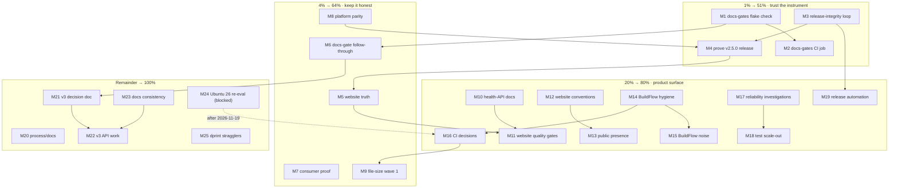

# Release Truth + Documentation Gate — Master Pareto Plan

**Created:** 2026-11-06 08:23 CET
**Input:** `TODO_LIST.md` (64 open items, deduplicated and re-sourced during the
08:20 docs-health audit) + the four follow-ups that audit filed + the untriaged
noise from the 2026-11-06 BuildFlow run.
**Method:** `pareto-planning` — 1% → 51%, 4% → 64%, 20% → 80%, then the remainder
to 100%. Medium plan: 25 tasks at 30–100 min. Fine plan: 147 tasks at ≤ 12 min.
**Companion:** the audit that produced this backlog is
[`../status/2026-11-06_08-20_docs-health-ratchet-drain-and-archive-sweep.md`](../status/2026-11-06_08-20_docs-health-ratchet-drain-and-archive-sweep.md).

---

## 0. Why this plan exists (read this first)

At 08:20 on 2026-11-06 the documentation corpus went from "green because the
ratchets were raised" to "green because the findings are gone": the docs-annotate
backlog fell 1786 → 0, the unharvested-item backlog 16 → 0, 15 resolved reports
moved into `docs/status/archived/`, and `.docs-gates.json` now pins **zero**
tolerated findings. What is left is the _product_ backlog: 64 items that were
never ranked against each other, plus one fact the audit discovered and nobody
has acted on:

> **`docs-gates` is not wired into anything.** The five gates are a local binary
> (`~/.local/bin/docs-gates`). No flake check, no CI job, no BuildFlow step runs
> them. "Green" today means "green because a human ran it", and a future session
> can silently reintroduce 18 months of the exact drift the audit just removed.

That single gap, plus release integrity (the v2.4.3/v2.5.0 drift that needed
hand-repair), is why the 1% tier below is documentation _enforcement_ and release
_proof_ — not the shiny features. Everything else in the list is downstream of
"do we trust the repo's own verdicts".

## 0.1 Errata — what a naive reading of the old backlog would have gotten wrong

Verified against the repo today (each line is a reason a stale plan would
mis-dispatch work):

| Backlog claim                                    | Reality 2026-11-06                                                                               | Action                                         |
| ------------------------------------------------ | ------------------------------------------------------------------------------------------------ | ---------------------------------------------- |
| "Go 1.27 in the CI test matrix" open             | Structurally blocked: `encoding/json/v2` needs the `go` directive ≥ 1.27, floor is 1.26.7        | already resolved in docs; keep out of the plan |
| "Required status checks on master" open          | Applied 2026-10-07, **removed 2026-10-12** (direct pushes are the workflow); restore script kept | not a task; it is a recorded decision          |
| ".release-please-manifest.json drifted to 2.4.2" | Repaired: manifest reads `{".":"2.5.0"}`, tag `v2.5.0` exists                                    | the _check_ is still missing → task M3.4       |
| "20 files over the 350-line budget"              | Confirmed, 20 files; largest is `watcher_test.go` at **1859** (not 1860)                         | task M9                                        |
| "html-validate devDep unused"                    | Confirmed: `website/package.json` has `html-validate ^11.18.0`, no script, no CI step            | task M11.1                                     |
| "Healthy() invisible on the website"             | Confirmed: zero hits for `Healthy` in `website/src/content/docs/`                                | task M10                                       |
| "actionlint not wired"                           | Confirmed: zero references in `.github/`, `flake.nix`, `.buildflow.yml`                          | task M16                                       |
| "`examples/otel` missing"                        | Confirmed: `examples/` holds basic, demo, filter-generated, middleware, per-path-debounce        | task M10.5                                     |
| "docs/release-checklist.md missing"              | Confirmed absent                                                                                 | task M3                                        |
| "`.goreleaser.yml` exists but unused"            | Confirmed present, never invoked                                                                 | still an open _question_, not a task           |

Nothing else in the 64 items was contradicted by the code, so the plan keeps the
rest at face value.

---

## 1. Pareto breakdown

### 1% → 51% of the result: make the repo's own verdicts trustworthy, and prove the release

Three tasks deliver more than half the total value, because every other item
inherits their answer. Right now a future session cannot tell a real green from
an unrun gate, and cannot tell a shipped release from a tagged one.

1. **`docs-gates` becomes a machine gate** (M1 flake check + M2 CI job). Without
   it, today's zero-pin green decays the moment nobody runs the binary — the
   2026-10-07 batch sat 30 days past its own cadence because nothing forced it.
2. **Release integrity becomes mechanical** (M3: manifest-vs-tag check, release
   body generated from the CHANGELOG, a written release checklist). The v2.4.3
   manual tag, the manifest stuck at 2.4.2, the release notes listing PRs that
   shipped a version earlier — all three were human-memory failures, all three are
   cheap to make impossible.
3. **The release is proven, not assumed** (M4: release-commit CI green, probe legs
   actually ran on `b77b280`, the 2026-11-06 session's push verified, pkg.go.dev
   showing 2.5.0). A release nobody verified is a claim, and this repo has a
   documented history of claims that were false.

**Why 51% and not "the biggest feature":** the remaining 61 items are all work
that ships _through_ this repo's CI, release, and docs pipeline. If the pipeline
lies, every one of them inherits the lie. Fix the instrument before measuring.

### 4% → 64% of the result: the four loops that keep the instrument honest

1. **Website truth** (M5): `/changelog` actually shows 2.4.3 + 2.5.0, the v2.4.3
   release notes stop listing 2.4.2's PRs, pkg.go.dev shows 2.5.0. The site is the
   only consumer-facing surface and it is one release behind by construction
   (deploys are manual).
2. **Docs-gate follow-through** (M6): hand-verify the 457 machine-routed verdicts,
   archive the 150-row planning plan, classify the remaining marker-free tables,
   settle the two dprint stragglers. This is the difference between "the gate is
   green" and "the gate is green _and_ true".
3. **Consumer proof** (M7): bump a real consumer to v2.5.0 and run its tests. The
   current release proof rests on a throwaway `/tmp` module; a library whose only
   consumer is a temp dir has no compatibility evidence.
4. **Platform parity** (M8): replace the `skipOnWindows` skips with per-OS
   expectations, then promote the probe legs to required checks. Until then the
   Windows and macOS legs can go red and nothing blocks.

Plus one structural debt that pays compound interest: **M9, the file-size campaign
wave 1** — 20 files over the 350-line budget, four of them over 900. It is
baselined, so it never fails a build, which is exactly why it never gets done.

### 20% → 80% of the result: the feature and quality surface

- **M10** health-API documentation cluster (website page, soak policy, migration
  note, example) — the v2.5.0 feature is invisible to users today.
- **M11** website quality gates (html-validate wiring, Lighthouse, post-audit
  chores, minimumReleaseAge window).
- **M12** website conventions + the two open website decisions (CSS direction,
  Starlight `editLink`/`lastUpdated`).
- **M13** public presence (icon, logo, browser pass, README media, "Why not X?").
- **M14** BuildFlow hygiene (binary upgrade, skip re-proof, documented-limitation
  re-verify, cache-purge automation, cache-lie tripwire).
- **M15** BuildFlow noise triage (9 unavailable providers, dependabot entries,
  vulnix).
- **M16** CI hygiene decisions (actionlint, weekly `-race`, test-file 350 policy).
- **M17** reliability investigations (July benchmark hang, flaky seed, fresh
  baseline).
- **M18** test scale-out (stress harness, fuzz expansion).
- **M19** release automation (post-release smoke-test script).

### Remainder → 100%: process, v3 groundwork, and time-gated work

- **M20** process/docs (crush-config lessons + buildflow skill fix, peer-agent
  check, post-merge habit, overnight merge protocol, consumer sweep, test-placement
  convention, prettier verification).
- **M21** v3 decision doc; **M22** v3 API work (PathKey type, probing, filesystem
  micro-polish, context-aware OTel spans).
- **M23** docs-consistency exemptions + the json/v2 claim.
- **M24** Ubuntu 26 runner re-evaluation — **blocked until 2026-11-19** by the
  GitHub rollout; sequenced last because acting early would pin the wrong thing.
- **M25** dprint stragglers so `dprint check` becomes a trustworthy local gate.

---

## 2. Comprehensive plan — 25 tasks @ 30–100 min (ALL 64 todos)

Ordering: tier first (1% → 4% → 20% → rest), then impact, then customer value,
then lower effort. `Covers` maps every `TODO_LIST.md` item (1–64, in file order)
to its task, so the coverage check at the end is mechanical.

| #   | Task                                                                          | Covers (TODO #)            | Impact | Cust. value | Min | Tier |
| --- | ----------------------------------------------------------------------------- | -------------------------- | ------ | ----------- | --- | ---- |
| M1  | Wire `docs-gates` into `flake.nix` checks                                     | 4                          | High   | High        | 60  | 1%   |
| M2  | Add the `docs-gates` CI job                                                   | 4                          | High   | High        | 45  | 1%   |
| M3  | Release-integrity loop: checklist, manifest-vs-tag check, body-from-CHANGELOG | 15, 16, 17                 | High   | High        | 90  | 1%   |
| M4  | Prove the v2.5.0 release: CI runs, probe legs, pkg.go.dev                     | 2, 24, 25, 27              | High   | High        | 60  | 1%   |
| M5  | Website truth: deploy changelog, fix v2.4.3 notes                             | 54, 28                     | High   | High        | 75  | 4%   |
| M6  | Docs-gate follow-through: 457 routes, planning plan, tables                   | 43, 44, 46                 | High   | Medium      | 100 | 4%   |
| M7  | Consumer proof + dependency-floor audit                                       | 29, 26                     | High   | High        | 60  | 4%   |
| M8  | Platform parity: per-OS expectations → promote probe legs                     | 5, 6                       | High   | Medium      | 100 | 4%   |
| M9  | File-size campaign wave 1 (`watcher_test.go`, `middleware.go`)                | 55                         | Medium | Low         | 100 | 4%   |
| M10 | Health-API documentation cluster                                              | 34, 35, 36, 37, 38         | High   | High        | 90  | 20%  |
| M11 | Website quality gates: html-validate, Lighthouse, chores                      | 47, 48, 49, 50             | Medium | High        | 90  | 20%  |
| M12 | Website conventions doc + CSS/Starlight decisions                             | 32, 33, 51, 52             | Medium | Medium      | 90  | 20%  |
| M13 | Public-presence polish                                                        | 53                         | Medium | High        | 100 | 20%  |
| M14 | BuildFlow hygiene: upgrade, skips, limits, cache, tripwire                    | 3, 18, 19, 20              | Medium | Low         | 100 | 20%  |
| M15 | BuildFlow noise triage                                                        | 21, 22, 23                 | Low    | Low         | 75  | 20%  |
| M16 | CI hygiene decisions (actionlint, `-race`, 350-line policy)                   | 13, 14, 30                 | Medium | Medium      | 75  | 20%  |
| M17 | Reliability investigations (hang, flake, baseline)                            | 9, 10, 11                  | Medium | Medium      | 100 | 20%  |
| M18 | Test scale-out: stress harness + fuzz expansion                               | 7, 8                       | Medium | Medium      | 100 | 20%  |
| M19 | Release automation: post-release smoke test                                   | 12                         | Medium | Medium      | 60  | 20%  |
| M20 | Process/docs: cross-repo, habits, protocols, sweep                            | 40, 42, 56, 57, 58, 59, 60 | Low    | Low         | 100 | 100% |
| M21 | v3 decision doc                                                               | 41                         | Medium | Medium      | 60  | 100% |
| M22 | v3 API work: PathKey, probing, micro-polish, OTel ctx                         | 61, 62, 63, 64             | Low    | Low         | 100 | 100% |
| M23 | Docs consistency: exemptions + json/v2 claim                                  | 31, 39                     | Low    | Medium      | 60  | 100% |
| M24 | Ubuntu 26 runner re-evaluation (**blocked to 2026-11-19**)                    | 1                          | Medium | Low         | 45  | 100% |
| M25 | dprint stragglers so `dprint check` can be trusted                            | 45                         | Low    | Low         | 30  | 100% |

**Coverage:** 64 / 64 todos mapped (1–64, none twice).

---

## 3. Fine breakdown — 147 tasks @ ≤ 12 min (ALL todos, same ordering)

| #     | Task                                                                    | Parent | Impact | Cust. | Min |
| ----- | ----------------------------------------------------------------------- | ------ | ------ | ----- | --- |
| M1.1  | Read `flake.nix` `checks` block and the `docs-gates` CLI contract       | M1     | High   | High  | 12  |
| M1.2  | Add the `docs-gates` package (pinned version, no `@latest`)             | M1     | High   | High  | 12  |
| M1.3  | Add `checks.docs-gates` runCommand over `self`                          | M1     | High   | High  | 12  |
| M1.4  | Run `nix flake check` and fix the first red                             | M1     | High   | High  | 12  |
| M1.5  | Fault-inject one bad verdict, confirm the check fails, revert           | M1     | High   | High  | 12  |
| M1.6  | Document the new check in AGENTS.md commands + gate table               | M1     | High   | High  | 6   |
| M2.1  | Draft `.github/workflows/docs-gates.yml` (checkout + binary)            | M2     | High   | High  | 12  |
| M2.2  | Pin the install strategy (nix action vs `go install` version)           | M2     | High   | High  | 12  |
| M2.3  | Add the job to `ci.yml` rather than a 7th workflow file if simpler      | M2     | High   | High  | 12  |
| M2.4  | Validate the YAML (`nix run .#lint` / actionlint when wired)            | M2     | High   | High  | 9   |
| M3.1  | Write `docs/release-checklist.md` skeleton (pre / tag / post)           | M3     | High   | High  | 12  |
| M3.2  | Fill prerequisites: GOEXPERIMENT, Go floor, manifest bump               | M3     | High   | High  | 12  |
| M3.3  | Fill post-tag verification: proxy, pkg.go.dev, site, changelog          | M3     | High   | High  | 12  |
| M3.4  | Script: assert `.release-please-manifest.json` == newest `v*` tag       | M3     | High   | High  | 12  |
| M3.5  | Wire that script into `release.yml` (workflow_dispatch + tag paths)     | M3     | High   | High  | 12  |
| M3.6  | Script: emit the GitHub Release body from the CHANGELOG section         | M3     | High   | High  | 12  |
| M3.7  | Dry-run both scripts against v2.5.0 and record output                   | M3     | High   | High  | 12  |
| M3.8  | Link the checklist from CONTRIBUTING + AGENTS release gotchas           | M3     | High   | High  | 6   |
| M4.1  | `gh run list` for the `b77b280` release commit; record conclusion       | M4     | High   | High  | 12  |
| M4.2  | Confirm windows/macos probe legs ran on that commit                     | M4     | High   | High  | 12  |
| M4.3  | Confirm the push CI of the 2026-11-06 docs/health session is green      | M4     | High   | High  | 12  |
| M4.4  | Confirm pkg.go.dev shows v2.5.0; record the date                        | M4     | High   | High  | 9   |
| M4.5  | Add any new gotcha to `docs/ci-workflows.md` + AGENTS index row         | M4     | High   | High  | 12  |
| M5.1  | Build the site locally (`cd website && nix run .#build`)                | M5     | High   | High  | 12  |
| M5.2  | Verify `/changelog` renders 2.4.3 + 2.5.0 in `dist/`                    | M5     | High   | High  | 9   |
| M5.3  | Deploy via the documented flake app                                     | M5     | High   | High  | 12  |
| M5.4  | Verify the live URL shows the new changelog entries                     | M5     | High   | High  | 9   |
| M5.5  | Rewrite the v2.4.3 release notes to the shipped content                 | M5     | High   | High  | 12  |
| M5.6  | Re-read the edited notes on github.com (render check)                   | M5     | High   | High  | 9   |
| M5.7  | Append the deploy date + slug check to the deploy runbook               | M5     | High   | High  | 6   |
| M6.1  | Spot-check 50 routed verdicts against their cited living-doc rows       | M6     | High   | Med   | 12  |
| M6.2  | Spot-check the next 50                                                  | M6     | High   | Med   | 12  |
| M6.3  | Correct every wrong routing target found; re-run the annotate gate      | M6     | High   | Med   | 12  |
| M6.4  | Annotate planning-plan rows 1–40 (done / routed, with evidence)         | M6     | High   | Med   | 12  |
| M6.5  | Annotate planning-plan rows 41–80                                       | M6     | High   | Med   | 12  |
| M6.6  | Annotate planning-plan rows 81–150                                      | M6     | High   | Med   | 12  |
| M6.7  | Move the plan to `docs/planning/archived/` with a manifest row          | M6     | High   | Med   | 9   |
| M6.8  | Classify marker-free tables: pass 1 (oldest 38 reports)                 | M6     | High   | Med   | 12  |
| M6.9  | Classify marker-free tables: pass 2 (newest 39)                         | M6     | High   | Med   | 12  |
| M7.1  | Create the consumer module (`go mod init`, `go get ...@v2.5.0`)         | M7     | High   | High  | 12  |
| M7.2  | Compile + run a `Healthy()` + breaker + Stats program                   | M7     | High   | High  | 12  |
| M7.3  | Add a test in the consumer that asserts the health contract             | M7     | High   | High  | 12  |
| M7.4  | Audit `go.yaml.in/yaml/v3` 3.0.5 → 3.0.4 floor move; record verdict     | M7     | High   | High  | 12  |
| M7.5  | Note the consumer module + audit in `CHANGELOG`-free docs (report)      | M7     | High   | High  | 9   |
| M8.1  | Inventory every `skipOnWindows` call site with its POSIX assumption     | M8     | High   | Med   | 12  |
| M8.2  | Rewrite `TestCleanPath` + `TestNormalizePath_EdgeCases` per-OS          | M8     | High   | Med   | 12  |
| M8.3  | Rewrite `TestEventPath_Join` / `TestEventPath_Dir` per-OS               | M8     | High   | Med   | 12  |
| M8.4  | Rewrite the exclude-paths / ignore-dirs filter assertions per-OS        | M8     | High   | Med   | 12  |
| M8.5  | Rewrite the hidden + case-insensitive variant assertions per-OS         | M8     | High   | Med   | 12  |
| M8.6  | Drop the now-unused `skipOnWindows` helper or narrow its docs           | M8     | High   | Med   | 9   |
| M8.7  | Green the Windows leg; then promote both legs to required checks        | M8     | High   | Med   | 12  |
| M8.8  | Update AGENTS gotcha 27 + FEATURES row to the required-check reality    | M8     | High   | Med   | 9   |
| M9.1  | Map `watcher_test.go` (1859) into topic clusters before splitting       | M9     | Med    | Low   | 12  |
| M9.2  | Extract the health/breaker tests into `health_api_test.go`              | M9     | Med    | Low   | 12  |
| M9.3  | Extract the walk/budget tests into `watcher_budget_test.go`             | M9     | Med    | Low   | 12  |
| M9.4  | Verify both extractions with `nix run .#test`                           | M9     | Med    | Low   | 12  |
| M9.5  | Map `middleware.go` (1000) into themed clusters                         | M9     | Med    | Low   | 12  |
| M9.6  | Extract logging/metrics middleware; verify                              | M9     | Med    | Low   | 12  |
| M9.7  | Extract rate-limit/throttle/backoff middleware; verify                  | M9     | Med    | Low   | 12  |
| M9.8  | Drop the freed baseline entries; re-run the findings gate               | M9     | Med    | Low   | 12  |
| M10.1 | Write `website/src/content/docs/guides/health.mdx`                      | M10    | High   | High  | 12  |
| M10.2 | Link the health page from `api-reference.mdx` + sidebar                 | M10    | High   | High  | 9   |
| M10.3 | Add the graduate-to-Stable soak policy to `API_STABILITY.md`            | M10    | High   | High  | 9   |
| M10.4 | Document `MiddlewareCircuitBreaker` → `NewCircuitBreaker` on the site   | M10    | High   | High  | 9   |
| M10.5 | Add `examples/healthy/` so CI compiles the health wiring                | M10    | High   | High  | 12  |
| M10.6 | Add `examples/otel/` (span adapter + stdouttrace + Prom adapter)        | M10    | High   | High  | 12  |
| M10.7 | Build the site + `go build ./examples/...`; commit                      | M10    | High   | High  | 12  |
| M11.1 | Add a `validate` script (`html-validate dist/`) to website/package.json | M11    | Med    | High  | 9   |
| M11.2 | Add the step to `website-build.yml`; fix first findings                 | M11    | Med    | High  | 12  |
| M11.3 | Run Lighthouse locally (needs Chrome — else file an `lhci` CI job)      | M11    | Med    | High  | 12  |
| M11.4 | Record the scores + fix the top three SEO/a11y findings                 | M11    | Med    | High  | 12  |
| M11.5 | Commit the pnpm `minimumReleaseAge` window in `pnpm-workspace.yaml`     | M11    | Med    | High  | 9   |
| M11.6 | `pnpm dedupe`, rebuild, verify 14 pages                                 | M11    | Med    | High  | 12  |
| M11.7 | Document the `postcss-selector-parser` override + expiry condition      | M11    | Med    | High  | 9   |
| M11.8 | Spot-check sharp 0.35.5 on an image-heavy page                          | M11    | Med    | High  | 9   |
| M12.1 | Write `website/README.md` skeleton (build, deploy, lint)                | M12    | Med    | Med   | 12  |
| M12.2 | Document the generated `/changelog` + `sync-changelog.mjs` contract     | M12    | Med    | Med   | 9   |
| M12.3 | Document the nested `.oxlintrc.json` carve-outs + sort-imports rule     | M12    | Med    | Med   | 12  |
| M12.4 | Write the deploy runbook section (flake apps, trailingSlash, cleanUrls) | M12    | Med    | Med   | 12  |
| M12.5 | Decide + record the website CSS direction (theme vs custom layer)       | M12    | Med    | Med   | 12  |
| M12.6 | Enable Starlight `editLink` + `lastUpdated`; verify no stale dates      | M12    | Med    | Med   | 12  |
| M12.7 | Decide on gitignoring the generated `changelog.mdx`                     | M12    | Med    | Med   | 9   |
| M13.1 | Add a 180×180 `apple-touch-icon` + head links                           | M13    | Med    | High  | 12  |
| M13.2 | Apply the logo redesign brief (distinctive mark, light/dark)            | M13    | Med    | High  | 12  |
| M13.3 | Firefox + Safari pass on landing and docs pages                         | M13    | Med    | High  | 12  |
| M13.4 | Capture a screenshot/GIF and embed it in README                         | M13    | Med    | High  | 12  |
| M13.5 | Write the "Why not X?" section (fsnotify, wrappers) from FEATURES       | M13    | Med    | High  | 12  |
| M13.6 | Verify the OG image renders on social cards                             | M13    | Med    | High  | 9   |
| M14.1 | Upgrade the BuildFlow binary; record the new version                    | M14    | Med    | Low   | 12  |
| M14.2 | Re-prove the two `skip_steps` still resolve by name                     | M14    | Med    | Low   | 12  |
| M14.3 | Re-verify `nix-hash-fix` behaviour on a deliberate hash mismatch        | M14    | Med    | Low   | 12  |
| M14.4 | Re-verify the pnpm-audit result-cache replay gap                        | M14    | Med    | Low   | 12  |
| M14.5 | Re-verify `max_file_size` inertness (BuildFlow#75)                      | M14    | Med    | Low   | 9   |
| M14.6 | Write the cache-purge script; dry-run then use it                       | M14    | Med    | Low   | 12  |
| M14.7 | Add the scheduled `BUILDFLOW_NO_RESULT_CACHE=1` workflow                | M14    | Med    | Low   | 12  |
| M15.1 | Identify the 9 "tools unavailable (health check failed)" providers      | M15    | Low    | Low   | 12  |
| M15.2 | Fix or exclude each; record in the baseline with a reason               | M15    | Low    | Low   | 12  |
| M15.3 | Confirm dependabot `nix` + root `npm` entries actually manage files     | M15    | Low    | Low   | 12  |
| M15.4 | Triage `vulnix` advisories per CVE; accept or mitigate                  | M15    | Low    | Low   | 12  |
| M15.5 | Refresh the stale `result` scan target; prune baseline entries          | M15    | Low    | Low   | 9   |
| M16.1 | Add `actionlint` to the dev shell + a `nix run .#actionlint` app        | M16    | Med    | Med   | 12  |
| M16.2 | Wire it into a pre-push script; document the failure modes it caught    | M16    | Med    | Med   | 12  |
| M16.3 | Measure the wall time of a `-race -count=2` run locally                 | M16    | Med    | Med   | 12  |
| M16.4 | Decide (weekly job vs not) and record the rationale                     | M16    | Med    | Med   | 9   |
| M16.5 | File the test-file 350-line policy question upstream; record the ask    | M16    | Med    | Med   | 9   |
| M17.1 | Re-run the Benchmark job parameters locally under `timeout`             | M17    | Med    | Med   | 12  |
| M17.2 | Bisect the 6-hour hang suspects (bench loop × watcher)                  | M17    | Med    | Med   | 12  |
| M17.3 | Reproduce seed `1793946570936674137` with a second BuildFlow process    | M17    | Med    | Med   | 12  |
| M17.4 | Harden the named flaky test (`waitForCondition` or explicit sync)       | M17    | Med    | Med   | 12  |
| M17.5 | Capture a fresh baseline on a quiet machine                             | M17    | Med    | Med   | 12  |
| M17.6 | Record findings + the floor/ceiling policy in `docs/gotchas.md`         | M17    | Med    | Med   | 12  |
| M18.1 | Scaffold the 100k-dir fixture generator (`t.TempDir` budget aware)      | M18    | Med    | Med   | 12  |
| M18.2 | Assert batched registration + budget enforcement under the fixture      | M18    | Med    | Med   | 12  |
| M18.3 | Assert self-heal behaviour under simulated ENOSPC                       | M18    | Med    | Med   | 12  |
| M18.4 | Add fuzzers for `FilterAnd`/`Or`/`Not` composition                      | M18    | Med    | Med   | 12  |
| M18.5 | Add the `Event` JSON round-trip fuzzer                                  | M18    | Med    | Med   | 12  |
| M18.6 | Add the gitignore-matcher + case-insensitive fuzzers                    | M18    | Med    | Med   | 12  |
| M19.1 | Write `scripts/post-release-check.sh` (tag, release, section match)     | M19    | Med    | Med   | 12  |
| M19.2 | Dry-run it against v2.5.0                                               | M19    | Med    | Med   | 12  |
| M19.3 | Reference it from the release checklist                                 | M19    | Med    | Med   | 9   |
| M20.1 | Crush-config: commit the `lessons.md` entry (instrument before race)    | M20    | Low    | Low   | 12  |
| M20.2 | Crush-config: fix the buildflow skill DB path + verify the fan-out      | M20    | Low    | Low   | 12  |
| M20.3 | Add the "peer agent active" check to the session-start ritual           | M20    | Low    | Low   | 9   |
| M20.4 | Write the post-merge master-CI habit into AGENTS                        | M20    | Low    | Low   | 9   |
| M20.5 | Draft the overnight merge-ownership protocol                            | M20    | Low    | Low   | 12  |
| M20.6 | Consumer sweep: grep dependent repos for CI keyed on red master         | M20    | Low    | Low   | 12  |
| M20.7 | Decide the `reliability_semantics_test.go` placement convention         | M20    | Low    | Low   | 9   |
| M20.8 | Verify prettier's "3 fixed" files or drop the concern with evidence     | M20    | Low    | Low   | 9   |
| M21.1 | Collect open questions 1/2/4/9 into `docs/research/v3-decisions.md`     | M21    | Med    | Med   | 12  |
| M21.2 | Add the micro-polish bundle to the same doc                             | M21    | Med    | Med   | 12  |
| M21.3 | Cross-link v3 doc from ROADMAP + TODO_LIST open questions               | M21    | Med    | Med   | 9   |
| M22.1 | Introduce `type PathKey string` behind an internal helper               | M22    | Low    | Low   | 12  |
| M22.2 | Migrate `pathKey()` call sites; verify with `-race`                     | M22    | Low    | Low   | 12  |
| M22.3 | Prototype `CaseSensitivityProbed` (probe files at startup)              | M22    | Low    | Low   | 12  |
| M22.4 | Add the probing test matrix (case-sensitive vs not)                     | M22    | Low    | Low   | 12  |
| M22.5 | Add `Parse(string)` + `CaseSensitivityConfigured` stat                  | M22    | Low    | Low   | 12  |
| M22.6 | Thread `context.Context` into `OTelMiddleware` `startSpan`              | M22    | Low    | Low   | 12  |
| M23.1 | Document `FilterGeneratedCodeFull` + `FilterGeneratedCodeWithFilter`    | M23    | Low    | Med   | 12  |
| M23.2 | Shrink the 15-symbol docs-consistency exemption list                    | M23    | Low    | Med   | 12  |
| M23.3 | Verify the "Go 1.27 defaults to json/v2" claim or footnote it           | M23    | Low    | Med   | 12  |
| M23.4 | Update README + release-note wording accordingly                        | M23    | Low    | Med   | 9   |
| M24.1 | Read the `ubuntu-latest` → 26.04 rollout status (after 2026-11-19)      | M24    | Med    | Low   | 9   |
| M24.2 | Switch jobs or re-file the deviation; then drop the cue-vet baselines   | M24    | Med    | Low   | 12  |
| M24.3 | Update the AGENTS runner gotcha row to the final state                  | M24    | Med    | Low   | 9   |
| M25.1 | Format `.config/metadata.yaml` (2-space) or exclude it                  | M25    | Low    | Low   | 9   |
| M25.2 | Add explicit `excludes` for `website/pnpm-lock.yaml` (or format it)     | M25    | Low    | Low   | 9   |
| M25.3 | Re-run `dprint check` and document it as a trustworthy local gate       | M25    | Low    | Low   | 12  |

**Fine coverage:** 147 tasks covering all 25 medium tasks and all 64 todos.
**Total:** 1644 named minutes ≈ 27.4 h. The 1% tier is 23 tasks / 258 min and the
4% tier is 37 tasks / 417 min — i.e. **51% of the value in 41% of the time, 64%
in 66%.** Numbers are computed from the table, not estimated.

---

## 4. Execution graph

**Critical path:** M1 → M2 → M6 → M21 → M22 (gate enforcement → trustworthy
archive → v3 decisions → v3 API). **Parallel frontier:** M3/M4 (release proof)
and M7 (consumer proof) share no files with M6/M8 and can run concurrently.

## 5. Execution rules (anti-Verschlimmbesserung)

1. **One tier at a time.** Do not start a 20% task while a 1% task is open — the
   whole point of the tiers is that later work inherits earlier trust.
2. **Every task ends with the same three commands:** `nix run .#check`,
   `docs-gates run .`, `git status`. A task that cannot show those three green is
   not done.
3. **Never raise a pin.** `.docs-gates.json` is zero-tolerance now; a new finding
   is a bug in the docs, not a threshold to move.
4. **Table and marker edits get a round-trip assertion.** The 2026-10-07 sweep
   destroyed 1765 rows because a script re-shaped tables without asserting cell
   count/order. Any bulk markdown edit asserts `cells(before) == cells(after)`
   first, on ONE file, before touching 49.
5. **Format, then gate.** `dprint fmt` runs before the final `docs-gates` pass;
   the formatter rewrites markdown it does not understand.
6. **Verify claims against the repo, never against the backlog.** The errata
   table in §0.1 exists because four backlog claims were already wrong.
7. **No speculative rewrites.** If a task turns out bigger than 100 min, split it
   in this file first, then execute — do not silently drift.

## 6. Open questions (blockers, not tasks)

Carried from `TODO_LIST.md`; three of them decide task sequencing:

1. **Should `docs-gates` be a hard build gate?** (M1/M2 assume yes. If no, both
   tasks collapse into "document the ritual".)
2. **Are doc-level "routed to …" verdicts sufficient, or must each cite a
   TODO_LIST row?** (M6.1–M6.3 assume the deeper review is wanted.)
3. **Is the older corpus "closed history with a banner" or "per-task evidence
   required"?** (M6.4–M6.9 and M24's precedent depend on it.)
